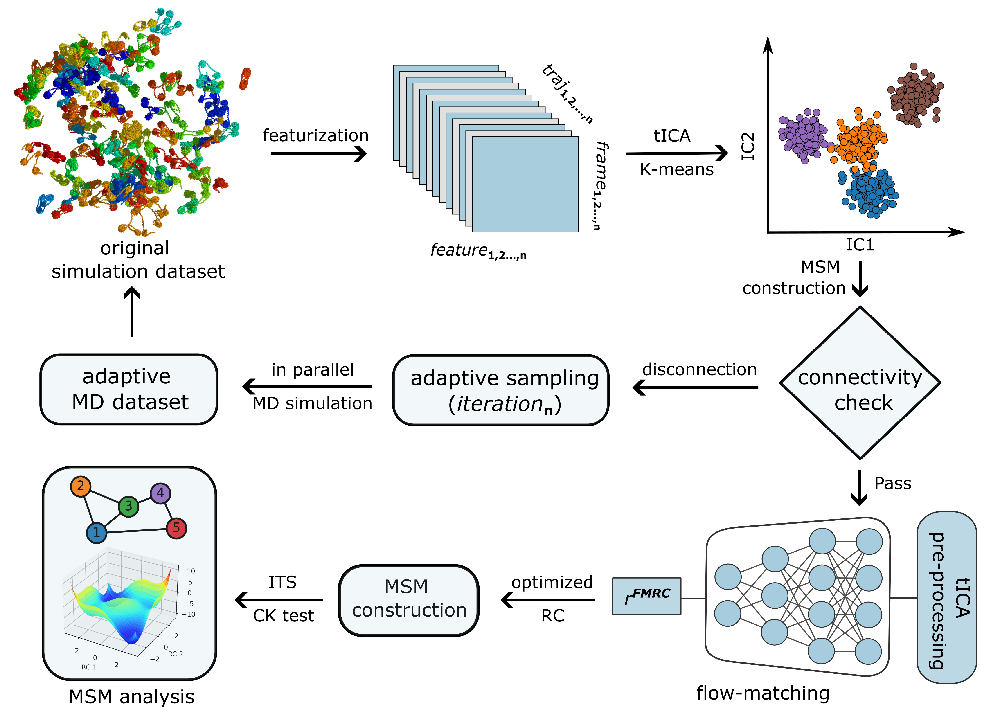

# Chromatin_MSM


Python package combining sampling of chromatin structures and recording features:

- **`Chromatin_MSM.adaptive`** — adaptive MSM sampling pipeline
- **`Chromatin_MSM.feature_writer`** — PLUMED collective-variable feature generator

The MSM construction, validation and analysis can be found in `MSM_analysis/MSM_FMRC.ipynb`

## Installation

```bash
git clone https://github.com/CollepardoLab/Chromatin_MSM.git
cd Chromatin_MSM
pip install -e .
```

### Required packages

**Core dependencies** (install via pip/conda): `numpy`, `pandas`, `matplotlib`, `scipy`, `networkx`, `mdtraj`

**Versioned dependencies:**
- `python` (3.9+)
- `openmm` (8.1.2)
- `plumed` (2.9.2 / `py-plumed` 2.9.2)
- `pytorch` (2.7.1 with CUDA 12.6 support)
- `deeptime`

**Manual installation required:**
- [`OpenCGChromatin`](https://github.com/CollepardoLab/OpenCGChromatin)

**External algorithm:**
- FMRC ([original implementation](https://github.com/Mingyuan00/Flow_Matching_for_RC))

## Usage

```bash
# Generate PLUMED CV definitions 
nucleosome-feature-writer --pdb ref/15/15rep.pdb --linker-length 15

# Run the adaptive MSM sampling pipeline
nucleosome-adaptive-sampling --n-rounds 8 --n-seed-per-round 16 --linker-length 15
```
### Before running `nucleosome-adaptive-sampling`

`adaptive.py` reads several inputs as **paths relative to the current working
directory**, and does not create or fetch them for you. Before invoking the CLI,
the run directory must contain:

| Path | Required content |
|------|-------------------|
| `./traj_dat/*.xtc` | Original seed trajectories (see `--n-original-sims` in the code / `n_original_sims`) |
| `./ref/<linker-length>/<linker-length>rep.pdb` | Reference topology. Default derived from `--linker-length` (e.g. `--linker-length 15` -> `ref/15/15rep.pdb`); override with `--topology-file` if your structure lives elsewhere |
| `./mdp_features.dat` | PLUMED CV definitions, generated with `nucleosome-feature-writer` (defaults to `mdp_features.dat`, matching what `adaptive.py` expects; override with `--output` on the writer and `--feature-file` on `adaptive.py` if you want a different name/path) |

See `scripts/new.sh` for an example SLURM submission script for the adaptive-sampling
pipeline, implementing CUDA Multi-Process Service (MPS) on a GPU cluster.

## Detailed docs

- [`docs/adaptive.md`](docs/adaptive.md) — adaptive MSM sampling pipeline
- [`docs/feature_writer.md`](docs/feature_writer.md) — PLUMED feature generator
- [`docs/reference_structures.md`](docs/reference_structures.md) - reference structure generation method

## Layout

```
Chromatin_MSM/
├── pyproject.toml
├── docs/
│   ├── adaptive.md              # adaptive sampling docs
│   ├── feature_writer.md        # feature generation docs
│   └── reference_structures.md  # reference structure generation docs
├── scripts/
│   ├── new.sh                   # SLURM submission script
│   └── setup_adaptive_run.sh    # stage ref/mdp_features.dat/traj_dat for a run dir
├── src/Chromatin_MSM/
│   ├── __init__.py
│   ├── adaptive.py               # adaptive MSM sampling pipeline
│   └── feature_writer.py         # PLUMED feature generator
├── ref/                          # reference structures, by linker length (bp) and DNA sequences
│   ├── 15/15rep.pdb, core1-4.pdb, DNA.pdb, htail*_A-D.pdb, ...
│   ├── 20/ ... 22/ ... 25/ ... 25_A/ ... 25_AT/ ... 26/ ... 27/ ...
│   └── 28/ ... 29/ ... 30/ ... 30_A/ ... 30_AT/ ... 58/ ...
└── MSM_analysis/                 # MSM construction, validation and analysis notebooks
    └── MSM_FMRC.ipynb
```
## Citation
Please cite:
Chen, Y., Huertas, J., Maristany, M.J., Russell, K., Zhang, M., Farr, S.E., Espinosa, J.R., and Collepardo-Guevara, R. (2026). *A Spectrum of Free Energy Landscape Topologies Encodes Chromatin Polymorphism and Phase Separation*. bioRxiv. https://doi.org/10.64898/2026.06.19.733383


